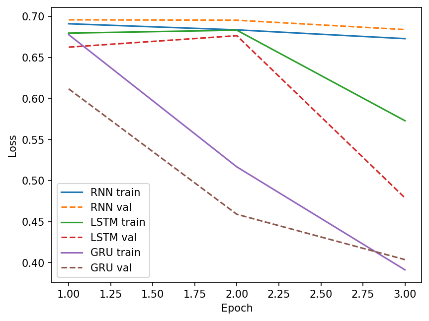
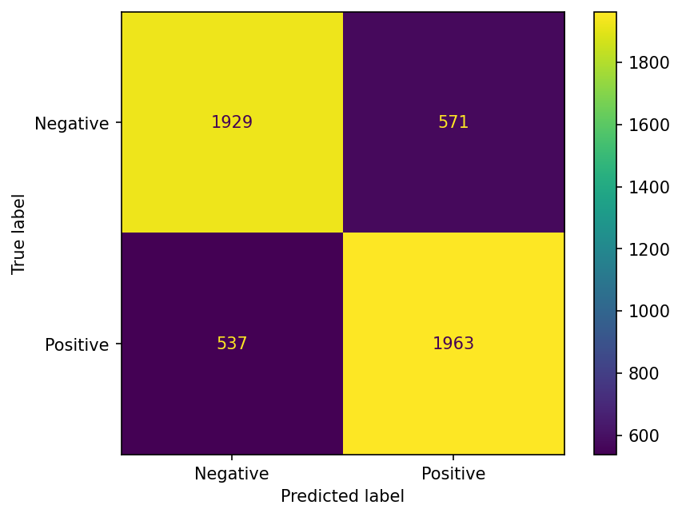

# LAB05 — Sequence Classification với RNN, LSTM và GRU

Bài thực hành phân loại cảm xúc review phim trên IMDb 50K, so sánh baseline **TF-IDF + Logistic Regression** với các mô hình **Embedding + RNN/LSTM/GRU**. Thực nghiệm khảo sát ảnh hưởng của sequence length, padding/truncation, vị trí từ khóa và phân tích dự đoán đúng/sai.

## 1. Các file trong thư mục

| File | Nội dung |
|---|---|
| [prediction.md](prediction.md) | Năm dự đoán trước thực nghiệm về thứ tự từ, dependency dài, thời gian train và truncation. |
| [sequence_classification.ipynb](sequence_classification.ipynb) | Notebook chính: đọc dữ liệu, tiền xử lý, huấn luyện, đánh giá, thử nghiệm sequence length và xuất kết quả. |
| [rnn_cell.py](rnn_cell.py) | Cài đặt `SimpleRNNCell` bằng NumPy; khi chạy trực tiếp sẽ đối chiếu đầu ra với `torch.nn.RNNCell` bằng trọng số cố định. |
| [results.csv](results.csv) | Kết quả của baseline, RNN, LSTM, GRU và LSTM ở các độ dài 50/100/200. |
| [learning_curves.png](learning_curves.png) | Train loss và validation loss qua 3 epochs của RNN, LSTM và GRU ở độ dài 100. |
| [confusion_matrix.png](confusion_matrix.png) | Confusion matrix trên test set của LSTM ở độ dài 100. |
| [error_analysis.md](error_analysis.md) | Ba ví dụ dự đoán đúng và ba ví dụ dự đoán sai của LSTM, kèm nhận xét ban đầu. |
| [reflection.md](reflection.md) | Tổng hợp kết quả, đối chiếu kiến trúc, ảnh hưởng của context và hướng phát triển sang Attention. |
| [README.md](README.md) | Giới thiệu bài thực hành và hướng dẫn chạy. |

## 2. Dữ liệu và cấu hình

- **Dataset:** [IMDb Dataset of 50K Movie Reviews trên Kaggle](https://www.kaggle.com/datasets/lakshmi25npathi/imdb-dataset-of-50k-movie-reviews), gồm 25.000 review positive và 25.000 review negative.
- **Chia dữ liệu:** 40.000 train, 5.000 validation, 5.000 test; chia phân tầng theo nhãn với seed `42`.
- **Tokenization cho sequence models:** chuyển chữ thường, tách token bằng regex; vocabulary xây dựng từ tập train, tổng cộng 10.000 mục gồm padding (`0`) và unknown (`1`).
- **Padding/truncation:** giữ các token đầu tiên tới `max_length`, thêm padding ở cuối nếu review ngắn hơn độ dài quy định.
- **Sequence models:** embedding dimension `32`, hidden size `32`, batch size `128`, `3` epochs; Adam với learning rate `0.002`, loss `BCEWithLogitsLoss`.
- **Thiết bị:** tự chọn CUDA nếu khả dụng, ngược lại dùng CPU.
- **Baseline:** `TfidfVectorizer(max_features=10000)` và `LogisticRegression(max_iter=300)`; TF-IDF được fit trên tập train và không áp dụng giới hạn token như sequence models.
- **Đánh giá:** Accuracy, Precision, Recall và binary F1, với positive là lớp `1` và ngưỡng dự đoán của sequence models là `0.5`.

## 3. Kết quả đã lưu

Các giá trị dưới đây lấy từ `results.csv`, làm tròn đến 4 chữ số thập phân cho Accuracy và F1.

| Mô hình | Max length | Accuracy | F1 | Thời gian (giây) | Tokens retained (%) |
|---|---:|---:|---:|---:|---:|
| TF-IDF + Logistic Regression | Không giới hạn | 0.8974 | 0.8971 | 10.35 | 100.00 |
| RNN | 100 | 0.5588 | 0.5032 | 24.92 | 41.37 |
| LSTM | 100 | 0.7784 | 0.7799 | 29.17 | 41.37 |
| GRU | 100 | 0.8140 | 0.8003 | 48.98 | 41.37 |
| LSTM | 50 | 0.7612 | 0.7574 | 17.31 | 21.45 |
| LSTM | 200 | 0.7390 | 0.7781 | 73.61 | 68.45 |

`Tokens_retained` của sequence models là tỷ lệ tổng số token còn lại sau truncation trên test set. Giá trị `100%` của baseline biểu thị không áp dụng truncation; baseline vẫn giới hạn vocabulary ở 10.000 đặc trưng. Trong CSV, `Max_length=0` và `Epochs=0` là các giá trị quy ước cho baseline.

Cột thời gian lấy từ `Training_time` của notebook: với sequence models, khoảng đo gồm huấn luyện, validation qua các epochs và dự đoán test; với baseline, khoảng đo gồm vectorization, fit và dự đoán test. Thời gian phụ thuộc môi trường chạy.

Trong lần chạy này, TF-IDF + Logistic Regression có Accuracy và F1 cao nhất. GRU cho kết quả tốt nhất trong ba sequence models ở độ dài 100. Tăng độ dài LSTM từ 50 lên 200 giữ được nhiều context hơn và tăng thời gian chạy, nhưng F1 cao nhất trong ba cấu hình nằm ở độ dài 100.

### Learning curves



Loss của GRU giảm rõ; loss của LSTM giảm mạnh ở epoch cuối, còn RNN cải thiện ít. Validation loss của LSTM tăng nhẹ từ epoch 1 sang 2 rồi giảm ở epoch 3. Với ba epochs, chưa đủ cơ sở kết luận mô hình đã overfit.

### Confusion matrix — LSTM, max_length = 100



Mô hình phân loại đúng 1.929 review negative và 1.963 review positive; 571 review negative bị dự đoán thành positive và 537 review positive bị dự đoán thành negative. Accuracy tương ứng là `3892 / 5000 = 0.7784`.

## 4. Cách chạy

### Chuẩn bị môi trường

Từ thư mục gốc `NLP`, cài các thư viện và chuyển vào `LAB05`:

```bash
python3 -m pip install numpy pandas matplotlib scikit-learn torch kagglehub jupyterlab
cd LAB05
```

Đặt file `IMDB Dataset.csv` trong `LAB05` nếu đã tải dữ liệu. Nếu không tìm thấy file cục bộ hoặc đường dẫn Kaggle khai báo sẵn, notebook dùng `kagglehub.dataset_download(...)` để tải dataset; bước này cần kết nối Internet và quyền truy cập Kaggle nếu được yêu cầu.

### Chạy RNN cell riêng

```bash
python3 rnn_cell.py
```

Script in đầu ra của cell và kết quả so sánh với PyTorch. Khi phép đối chiếu thành công, dòng cuối hiển thị `Khớp PyTorch: True`.

### Chạy notebook

Notebook hiện có cell tìm `rnn_cell.py` bằng đường dẫn Kaggle cố định:

```python
path = glob.glob('/kaggle/input/datasets/tngdngnguynlee/rnn-cell/rnn_cell.py', recursive=True)[0]
```

Khi chạy cục bộ từ `LAB05`, thay **toàn bộ cell import có đường dẫn Kaggle này** bằng:

```python
from rnn_cell import SimpleRNNCell
```

Sau đó mở notebook:

```bash
jupyter lab sequence_classification.ipynb
```

Chọn kernel của môi trường đã cài thư viện và chạy các cell từ trên xuống. Notebook tạo lại `results.csv`, `learning_curves.png`, `confusion_matrix.png` và `error_analysis.md` trong thư mục làm việc; các file cùng tên sẽ được ghi đè. `prediction.md` và `reflection.md` là tài liệu viết riêng.

## 5. Phạm vi diễn giải

- Kết quả phản ánh một lần chạy với seed `42` và ba epochs cho mỗi sequence model; chưa có thống kê qua nhiều seed.
- Notebook phát hiện 418 review trùng nhưng chưa loại bỏ trước khi chia dữ liệu. Review trùng có thể xuất hiện ở các tập khác nhau, ảnh hưởng đến đánh giá khả năng tổng quát hóa.
- Thực nghiệm độ dài 50/100/200 được thực hiện với **LSTM**. Chưa có kết quả RNN ở độ dài 50/200 hoặc cấu hình truncate về 30 token để kiểm chứng trực tiếp các prediction tương ứng.
- Thử nghiệm vị trí từ khóa cho thấy xác suất dự đoán thay đổi theo context, nhưng chưa chứng minh nguyên nhân là vanishing gradient.
- Các nhận xét trong `error_analysis.md` là gợi ý ban đầu từ sáu review trích đoạn; cần đọc toàn bộ review để xác định rõ vai trò của phủ định, tương phản và phần bị truncation.
