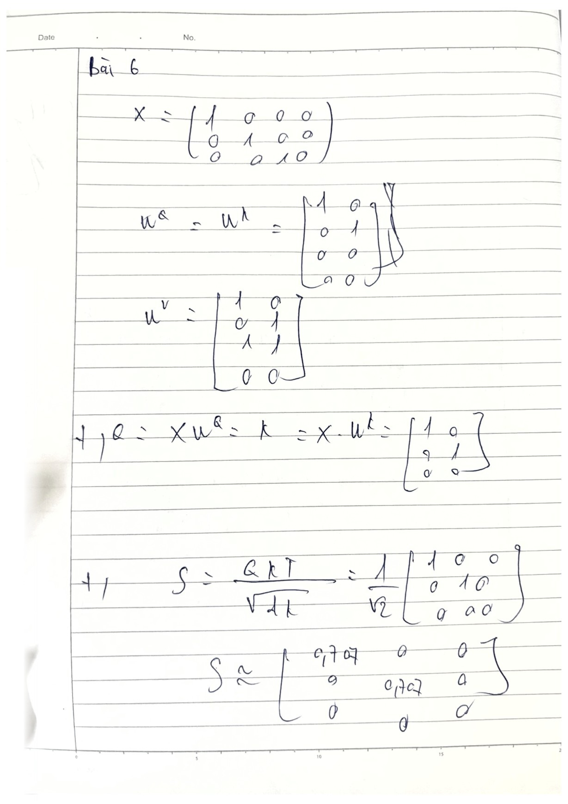
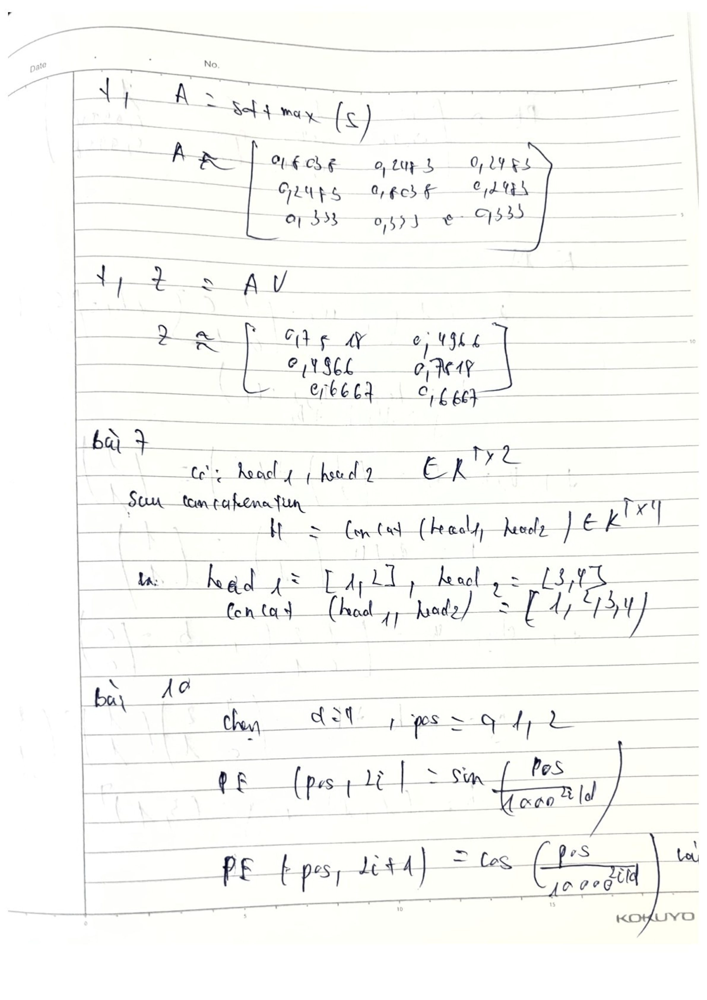
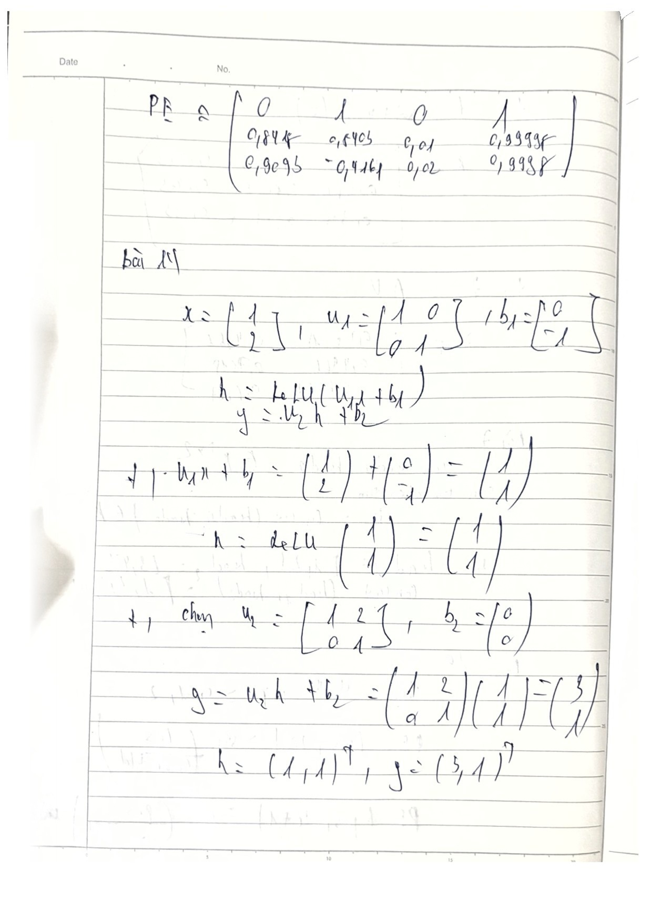
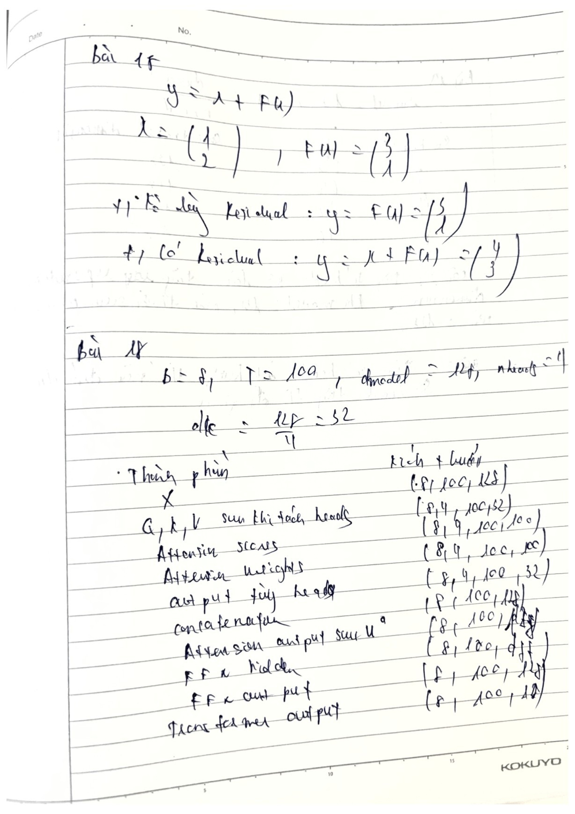
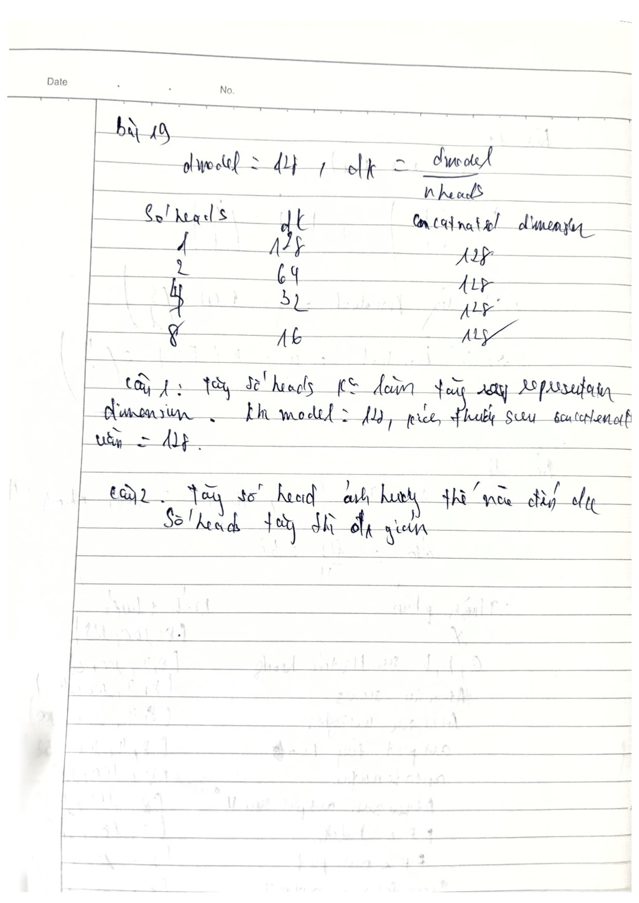

# Bài làm tính toán thủ công (Manual Calculations) — LAB 07

**Môn học:** Xử lý ngôn ngữ tự nhiên và ứng dụng  
**Chủ đề:** Transformer Architecture (From Attention to Transformer)  
**File bài làm:** `caculations.md` (đồng bộ cùng bản scan gốc: [`caculations.pdf`](./caculations.pdf))

---

## Mục lục bài làm

- [Bài 6: Tính toán Self-Attention thủ công (Manual Self-Attention Step-by-Step)](#bài-6-tính-toán-self-attention-thủ-công)
- [Bài 7: Ghép nối đa đầu chú ý (Multi-Head Concatenation)](#bài-7-ghép-nối-đa-đầu-chú-ý)
- [Bài 10: Tính toán Sinusoidal Positional Encoding](#bài-10-tính-toán-sinusoidal-positional-encoding)
- [Bài 14: Tính toán mạng truyền thẳng (Feed-Forward Network - FFN)](#bài-14-tính-toán-mạng-truyền-thẳng-feed-forward-network)
- [Bài 15: Tính toán bước nhảy tắt Residual Connection](#bài-15-tính-toán-bước-nhảy-tắt-residual-connection)
- [Bài 18: Bảng theo dõi Shape/Kích thước Tensor qua các tầng Transformer](#bài-18-bảng-theo-dõi-shapekích-thước-tensor)
- [Bài 19: Khảo sát ảnh hưởng của số lượng Attention Heads đến $d_k$](#bài-19-khảo-sát-ảnh-hưởng-của-số-lượng-attention-heads)

---

## Bản scan bài làm gốc (5 trang viết tay)

| Trang 1 | Trang 2 | Trang 3 | Trang 4 | Trang 5 |
| :---: | :---: | :---: | :---: | :---: |
|  |  |  |  |  |

---

## Bài 6: Tính toán Self-Attention thủ công

*(Tham khảo bài viết tay: Trang 1 & Trang 2)*

### 1. Dữ liệu đề bài

Ma trận đầu vào chuỗi gồm $T = 3$ tokens, mỗi token có số chiều biểu diễn $d = 4$:
$$X = \begin{pmatrix} 1 & 0 & 0 & 0 \\ 0 & 1 & 0 & 0 \\ 0 & 0 & 1 & 0 \end{pmatrix} \in \mathbb{R}^{3 \times 4}$$

Các ma trận chiếu trọng số Query, Key, Value với $d_k = d_v = 2$:
$$W^Q = W^K = \begin{pmatrix} 1 & 0 \\ 0 & 1 \\ 0 & 0 \\ 0 & 0 \end{pmatrix} \in \mathbb{R}^{4 \times 2}$$

$$W^V = \begin{pmatrix} 1 & 0 \\ 0 & 1 \\ 1 & 1 \\ 0 & 0 \end{pmatrix} \in \mathbb{R}^{4 \times 2}$$

---

### 2. Bước 1: Tính ma trận $Q, K, V$

$$Q = X W^Q = \begin{pmatrix} 1 & 0 & 0 & 0 \\ 0 & 1 & 0 & 0 \\ 0 & 0 & 1 & 0 \end{pmatrix} \begin{pmatrix} 1 & 0 \\ 0 & 1 \\ 0 & 0 \\ 0 & 0 \end{pmatrix} = \begin{pmatrix} 1 & 0 \\ 0 & 1 \\ 0 & 0 \end{pmatrix} \in \mathbb{R}^{3 \times 2}$$

$$K = X W^K = \begin{pmatrix} 1 & 0 & 0 & 0 \\ 0 & 1 & 0 & 0 \\ 0 & 0 & 1 & 0 \end{pmatrix} \begin{pmatrix} 1 & 0 \\ 0 & 1 \\ 0 & 0 \\ 0 & 0 \end{pmatrix} = \begin{pmatrix} 1 & 0 \\ 0 & 1 \\ 0 & 0 \end{pmatrix} \in \mathbb{R}^{3 \times 2}$$

$$V = X W^V = \begin{pmatrix} 1 & 0 & 0 & 0 \\ 0 & 1 & 0 & 0 \\ 0 & 0 & 1 & 0 \end{pmatrix} \begin{pmatrix} 1 & 0 \\ 0 & 1 \\ 1 & 1 \\ 0 & 0 \end{pmatrix} = \begin{pmatrix} 1 & 0 \\ 0 & 1 \\ 1 & 1 \end{pmatrix} \in \mathbb{R}^{3 \times 2}$$

---

### 3. Bước 2: Tính Attention Scores $S = \frac{Q K^T}{\sqrt{d_k}}$

Với $d_k = 2 \implies \sqrt{d_k} = \sqrt{2} \approx 1.4142 \implies \frac{1}{\sqrt{d_k}} \approx 0.7071$.

Tích vô hướng giữa các Query và Key:
$$Q K^T = \begin{pmatrix} 1 & 0 \\ 0 & 1 \\ 0 & 0 \end{pmatrix} \begin{pmatrix} 1 & 0 & 0 \\ 0 & 1 & 0 \end{pmatrix} = \begin{pmatrix} 1 & 0 & 0 \\ 0 & 1 & 0 \\ 0 & 0 & 0 \end{pmatrix} \in \mathbb{R}^{3 \times 3}$$

Chia cho căn bậc hai của số chiều $\sqrt{d_k}$:
$$S = \frac{Q K^T}{\sqrt{d_k}} = \frac{1}{\sqrt{2}} \begin{pmatrix} 1 & 0 & 0 \\ 0 & 1 & 0 \\ 0 & 0 & 0 \end{pmatrix} \approx \begin{pmatrix} 0.707 & 0 & 0 \\ 0 & 0.707 & 0 \\ 0 & 0 & 0 \end{pmatrix}$$

---

### 4. Bước 3: Tính Attention Weights $A = \text{softmax}(S)$

Thực hiện hàm Softmax theo từng hàng của ma trận $S$:

* **Hàng 1:** $S_1 = [0.707, 0, 0]$
  $$e^{0.707} \approx 2.0281, \quad e^0 = 1, \quad e^0 = 1$$
  $$\text{Tổng mẫu số} = 2.0281 + 1 + 1 = 4.0281$$
  $$A_{11} = \frac{2.0281}{4.0281} \approx 0.5038, \quad A_{12} = \frac{1}{4.0281} \approx 0.2481, \quad A_{13} = \frac{1}{4.0281} \approx 0.2481$$

* **Hàng 2:** $S_2 = [0, 0.707, 0]$
  $$A_{21} \approx 0.2481, \quad A_{22} \approx 0.5038, \quad A_{23} \approx 0.2481$$

* **Hàng 3:** $S_3 = [0, 0, 0]$
  $$e^0 = 1, \quad e^0 = 1, \quad e^0 = 1 \implies \text{Tổng mẫu số} = 3$$
  $$A_{31} = A_{32} = A_{33} = \frac{1}{3} \approx 0.3333$$

Ma trận Attention Weights:
$$A \approx \begin{pmatrix} 0.5038 & 0.2481 & 0.2481 \\ 0.2481 & 0.5038 & 0.2481 \\ 0.3333 & 0.3333 & 0.3333 \end{pmatrix}$$

---

### 5. Bước 4: Tính Output biểu diễn $Z = A V$

Nhân ma trận trọng số $A$ với ma trận giá trị $V$:
$$Z = A V = \begin{pmatrix} 0.5038 & 0.2481 & 0.2481 \\ 0.2481 & 0.5038 & 0.2481 \\ 0.3333 & 0.3333 & 0.3333 \end{pmatrix} \begin{pmatrix} 1 & 0 \\ 0 & 1 \\ 1 & 1 \end{pmatrix}$$

* **Hàng 1:**
  $$Z_1 = 0.5038 \begin{pmatrix} 1 & 0 \end{pmatrix} + 0.2481 \begin{pmatrix} 0 & 1 \end{pmatrix} + 0.2481 \begin{pmatrix} 1 & 1 \end{pmatrix}$$
  $$= \begin{pmatrix} 0.5038 + 0.2481 & 0.2481 + 0.2481 \end{pmatrix} = \begin{pmatrix} 0.7518 & 0.4966 \end{pmatrix}$$

* **Hàng 2:**
  $$Z_2 = 0.2481 \begin{pmatrix} 1 & 0 \end{pmatrix} + 0.5038 \begin{pmatrix} 0 & 1 \end{pmatrix} + 0.2481 \begin{pmatrix} 1 & 1 \end{pmatrix}$$
  $$= \begin{pmatrix} 0.2481 + 0.2481 & 0.5038 + 0.2481 \end{pmatrix} = \begin{pmatrix} 0.4966 & 0.7518 \end{pmatrix}$$

* **Hàng 3:**
  $$Z_3 = 0.3333 \begin{pmatrix} 1 & 0 \end{pmatrix} + 0.3333 \begin{pmatrix} 0 & 1 \end{pmatrix} + 0.3333 \begin{pmatrix} 1 & 1 \end{pmatrix}$$
  $$= \begin{pmatrix} 0.3333 + 0.3333 & 0.3333 + 0.3333 \end{pmatrix} = \begin{pmatrix} 0.6667 & 0.6667 \end{pmatrix}$$

Kết quả cuối cùng:
$$Z \approx \begin{pmatrix} 0.7518 & 0.4966 \\ 0.4966 & 0.7518 \\ 0.6667 & 0.6667 \end{pmatrix} \in \mathbb{R}^{3 \times 2}$$

---

## Bài 7: Ghép nối đa đầu chú ý (Multi-Head Concatenation)

*(Tham khảo bài viết tay: Trang 2)*

Cho 2 attention heads với kích thước mỗi head là $T \times 2$:
$$\text{head}_1, \text{head}_2 \in \mathbb{R}^{T \times 2}$$

Sau khi thực hiện phép nối (concatenation) theo trục đặc trưng (feature dimension):
$$H = \text{Concat}(\text{head}_1, \text{head}_2) \in \mathbb{R}^{T \times 4}$$

**Ví dụ minh họa:**
Giả sử vector output tại một bước token tương ứng là:
$$\text{head}_1 = [1, 2], \quad \text{head}_2 = [3, 4]$$
Khi ghép nối hai đầu lại với nhau:
$$\text{Concat}(\text{head}_1, \text{head}_2) = [1, 2, 3, 4] \in \mathbb{R}^4$$

---

## Bài 10: Tính toán Sinusoidal Positional Encoding

*(Tham khảo bài viết tay: Trang 2 & Trang 3)*

### 1. Công thức lý thuyết

Với số chiều biểu diễn $d$ và vị trí $pos$:
$$PE_{(pos, 2i)} = \sin\left(\frac{pos}{10000^{2i/d}}\right)$$
$$PE_{(pos, 2i+1)} = \cos\left(\frac{pos}{10000^{2i/d}}\right)$$

### 2. Áp dụng tính toán

Chọn $d = 4$, tính cho các vị trí $pos = 0, 1, 2$:
- Với $i = 0$: $2i = 0, 2i+1 = 1$, mẫu số $10000^{0/4} = 10000^0 = 1$
- Với $i = 1$: $2i = 2, 2i+1 = 3$, mẫu số $10000^{2/4} = 10000^{0.5} = 100$

**Chi tiết từng vị trí:**

* **Tại $pos = 0$:**
  - $PE_{(0, 0)} = \sin(0) = 0$
  - $PE_{(0, 1)} = \cos(0) = 1$
  - $PE_{(0, 2)} = \sin(0/100) = 0$
  - $PE_{(0, 3)} = \cos(0/100) = 1$
  $\to \text{Hàng } 0: [0, 1, 0, 1]$

* **Tại $pos = 1$:**
  - $PE_{(1, 0)} = \sin(1) \approx 0.8414$
  - $PE_{(1, 1)} = \cos(1) \approx 0.5403$
  - $PE_{(1, 2)} = \sin(1/100) = \sin(0.01) \approx 0.01$ (chính xác: $0.0099998$)
  - $PE_{(1, 3)} = \cos(1/100) = \cos(0.01) \approx 0.99995$
  $\to \text{Hàng } 1: [0.8414, 0.5403, 0.01, 0.99995]$

* **Tại $pos = 2$:**
  - $PE_{(2, 0)} = \sin(2) \approx 0.9093$
  - $PE_{(2, 1)} = \cos(2) \approx -0.4161$
  - $PE_{(2, 2)} = \sin(2/100) = \sin(0.02) \approx 0.02$ (chính xác: $0.019998$)
  - $PE_{(2, 3)} = \cos(2/100) = \cos(0.02) \approx 0.9998$
  $\to \text{Hàng } 2: [0.9093, -0.4161, 0.02, 0.9998]$

Ma trận Positional Encoding hoàn chỉnh:
$$PE \approx \begin{pmatrix} 0 & 1 & 0 & 1 \\ 0.8414 & 0.5403 & 0.01 & 0.99995 \\ 0.9093 & -0.4161 & 0.02 & 0.9998 \end{pmatrix}$$

---

## Bài 14: Tính toán mạng truyền thẳng (Feed-Forward Network)

*(Tham khảo bài viết tay: Trang 3)*

### 1. Kiến trúc mạng FFN 2 tầng

$$h = \text{ReLU}(W_1 x + b_1)$$
$$y = W_2 h + b_2$$

Đầu vào và tham số tầng 1:
$$x = \begin{pmatrix} 1 \\ 2 \end{pmatrix}, \quad W_1 = \begin{pmatrix} 1 & 0 \\ 0 & 1 \end{pmatrix}, \quad b_1 = \begin{pmatrix} 0 \\ -1 \end{pmatrix}$$

### 2. Tính toán tầng ẩn $h$

$$W_1 x + b_1 = \begin{pmatrix} 1 & 0 \\ 0 & 1 \end{pmatrix} \begin{pmatrix} 1 \\ 2 \end{pmatrix} + \begin{pmatrix} 0 \\ -1 \end{pmatrix} = \begin{pmatrix} 1 \\ 2 \end{pmatrix} + \begin{pmatrix} 0 \\ -1 \end{pmatrix} = \begin{pmatrix} 1 \\ 1 \end{pmatrix}$$
$$h = \text{ReLU}\left(\begin{pmatrix} 1 \\ 1 \end{pmatrix}\right) = \begin{pmatrix} 1 \\ 1 \end{pmatrix}$$

### 3. Tính toán tầng ra $y$

Chọn tham số tầng 2:
$$W_2 = \begin{pmatrix} 1 & 2 \\ 0 & 1 \end{pmatrix}, \quad b_2 = \begin{pmatrix} 0 \\ 0 \end{pmatrix}$$

$$y = W_2 h + b_2 = \begin{pmatrix} 1 & 2 \\ 0 & 1 \end{pmatrix} \begin{pmatrix} 1 \\ 1 \end{pmatrix} + \begin{pmatrix} 0 \\ 0 \end{pmatrix} = \begin{pmatrix} 1 \cdot 1 + 2 \cdot 1 \\ 0 \cdot 1 + 1 \cdot 1 \end{pmatrix} = \begin{pmatrix} 3 \\ 1 \end{pmatrix}$$

**Kết luận:**
$$h = (1, 1)^T, \quad y = (3, 1)^T$$

---

## Bài 15: Tính toán bước nhảy tắt Residual Connection

*(Tham khảo bài viết tay: Trang 4)*

Công thức kết nối tắt:
$$y = x + F(x)$$

Với vector đầu vào $x = \begin{pmatrix} 1 \\ 2 \end{pmatrix}$ và đầu ra của khối chuyển đổi $F(x) = \begin{pmatrix} 3 \\ 1 \end{pmatrix}$:

* **Trường hợp không dùng Residual:**
  $$y = F(x) = \begin{pmatrix} 3 \\ 1 \end{pmatrix}$$

* **Trường hợp có Residual Connection:**
  $$y = x + F(x) = \begin{pmatrix} 1 \\ 2 \end{pmatrix} + \begin{pmatrix} 3 \\ 1 \end{pmatrix} = \begin{pmatrix} 4 \\ 3 \end{pmatrix}$$

---

## Bài 18: Bảng theo dõi Shape/Kích thước Tensor

*(Tham khảo bài viết tay: Trang 4)*

### Thông số cấu hình thực nghiệm

* Batch size $B = 8$
* Chiều dài chuỗi $T = 100$
* Số chiều mô hình $d_{model} = 128$
* Số đầu chú ý $n_{heads} = 4$
* Kích thước mỗi head: $d_k = \frac{d_{model}}{n_{heads}} = \frac{128}{4} = 32$

### Bảng theo dõi Shape qua từng thành phần

| Thành phần trong Transformer | Kích thước Tensor (Shape) | Công thức chiều tổng quát |
| :--- | :---: | :---: |
| $X$ (Đầu vào mô hình) | `(8, 100, 128)` | $(B, T, d_{model})$ |
| $Q, K, V$ sau khi tách heads | `(8, 4, 100, 32)` | $(B, n_{heads}, T, d_k)$ |
| Attention scores ($Q K^T / \sqrt{d_k}$) | `(8, 4, 100, 100)` | $(B, n_{heads}, T, T)$ |
| Attention weights ($\text{softmax}$) | `(8, 4, 100, 100)` | $(B, n_{heads}, T, T)$ |
| Output từng heads ($A \cdot V$) | `(8, 4, 100, 32)` | $(B, n_{heads}, T, d_k)$ |
| Concatenation các heads | `(8, 100, 128)` | $(B, T, n_{heads} \times d_k)$ |
| Attention output sau chiếu $W^O$ | `(8, 100, 128)` | $(B, T, d_{model})$ |
| Tầng ẩn FFN (`FFN hidden`) | `(8, 100, 512)` hoặc `(8, 100, d_ff)` | $(B, T, d_{ff})$ |
| Đầu ra FFN (`FFN output`) | `(8, 100, 128)` | $(B, T, d_{model})$ |
| Transformer Block Output | `(8, 100, 128)` | $(B, T, d_{model})$ |

---

## Bài 19: Khảo sát ảnh hưởng của số lượng Attention Heads

*(Tham khảo bài viết tay: Trang 5)*

Cố định $d_{model} = 128$, công thức tính số chiều mỗi head:
$$d_k = \frac{d_{model}}{n_{heads}}$$

### Bảng so sánh

| Số lượng Attention Heads ($n_{heads}$) | Chiều mỗi head ($d_k$) | Kích thước sau khi nối lại ($n_{heads} \times d_k$) |
| :---: | :---: | :---: |
| **1** | $128 / 1 = 128$ | $128$ |
| **2** | $128 / 2 = 64$ | $128$ |
| **4** | $128 / 4 = 32$ | $128$ |
| **8** | $128 / 8 = 16$ | $128$ |

### Trả lời câu hỏi phân tích

* **Câu 1: Việc tăng số heads có làm thay đổi representation dimension không?**  
  **Trả lời:** Tăng số heads **không làm thay đổi** representation dimension. Khi $d_{model} = 128$, kích thước sau khi ghép nối (concatenation) vẫn luôn bằng $128$ vì $n_{heads} \times d_k = n_{heads} \times \frac{d_{model}}{n_{heads}} = d_{model} = 128$.

* **Câu 2: Tăng số heads ảnh hưởng thế nào đến $d_k$?**  
  **Trả lời:** Tăng số heads làm **$d_k$ giảm tỷ lệ nghịch** theo công thức $d_k = \frac{d_{model}}{n_{heads}}$. Khi số heads càng nhiều thì không gian đặc trưng của mỗi head càng hẹp lại (từ 128 chiều ở 1 head giảm dần xuống còn 16 chiều ở 8 heads).
