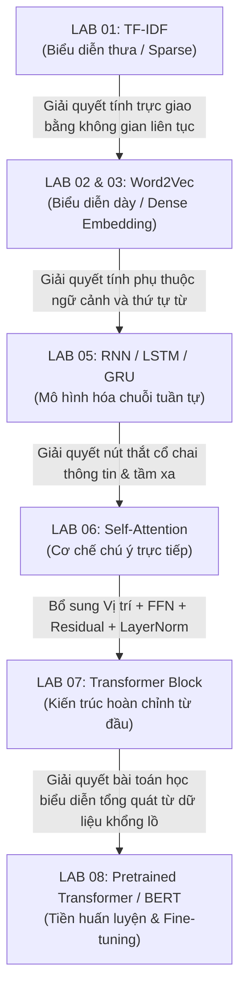

# Đúc kết & Phản hồi (Reflection) — LAB 07

Báo cáo đúc kết kiến thức toàn bộ chuỗi LAB 01 → LAB 07, phân tích cấu trúc Transformer và định hướng chuyển giao sang LAB 08 (theo Mục 27, 31, 35 của đề bài).

---

## 1. Mạch nối tiến hóa kiến thức từ LAB 01 → LAB 07

Qua 7 bài thực hành, lộ trình môn học thể hiện một bước chuyển mình mang tính lịch sử của lĩnh vực Xử lý Ngôn ngữ Tự nhiên: từ **Mô hình hóa chuỗi tuần tự (Sequence Modeling)** sang **Tương tác trực tiếp giữa các token (Direct Token Interaction)**.

### Chi tiết các hạn chế (Limitations) được khắc phục qua từng chặng:

* **TF-IDF (LAB 01):**
  * *Hạn chế (Limitation):* Biểu diễn rời rạc, số chiều rất lớn theo kích thước từ điển ($|V|$), các vector từ trực giao tuyệt đối với nhau nên không phản ánh được mức độ tương đồng ngữ nghĩa giữa các từ (ví dụ: "thông minh" và "sáng dạ" bị xem là hoàn toàn xa lạ).
* **Word2Vec (LAB 02 & 03):**
  * *Hạn chế (Limitation):* Là biểu diễn tĩnh (Static Embedding). Mỗi từ chỉ sở hữu một vector cố định duy nhất, không phụ thuộc vào ngữ cảnh xuất hiện, do đó hoàn toàn bất lực trước hiện tượng từ đa nghĩa (Polysemy — ví dụ từ "bank" trong "river bank" và "bank deposit" có cùng một vector).
* **RNN / LSTM / GRU (LAB 05):**
  * *Hạn chế (Limitation):* Bắt buộc phải xử lý tuần tự qua từng bước thời gian $t$ ($h_t = f(h_{t-1}, x_t)$). Điều này dẫn đến hai nhược điểm chí mạng:
    1. Không thể song song hóa quá trình tính toán trên GPU.
    2. Hiện tượng nút thắt cổ chai thông tin (Information Bottleneck) và suy giảm gradient khi khoảng cách giữa các từ trong câu quá xa (Long-range dependencies).
* **Attention Mechanism (LAB 06):**
  * *Hạn chế (Limitation):* Self-Attention cơ bản mới chỉ cho phép các từ nhìn thấy nhau, nhưng tự thân nó:
    1. Không có khái niệm thứ tự trước sau (Permutation invariant).
    2. Chỉ có 1 head đơn lẻ, không học được đồng thời nhiều loại liên kết ngữ nghĩa khác nhau.
    3. Thiếu các phép biến đổi phi tuyến cục bộ trên từng token (FFN).
    4. Thiếu cơ chế ổn định dòng gradient khi xếp chồng nhiều lớp (Residual + LayerNorm).
* **Transformer (LAB 07):**
  * *Giải pháp:* Ghép nối hoàn chỉnh: $\text{Embeddings} + \text{Positional Encoding} \to \text{Multi-Head Attention} \to \text{Residual/Norm} \to \text{FFN} \to \text{Residual/Norm}$.
  * *Hạn chế còn tồn đọng (Remaining Limitation):*
    1. Chi phí tính toán và bộ nhớ tăng theo bậc hai $O(T^2)$ theo chiều dài văn bản $T$.
    2. Mô hình hiện tại vẫn được huấn luyện từ đầu (Train from scratch) trên tập dữ liệu gán nhãn có hạn (IMDb 50K), rất dễ rơi vào tình trạng học vẹt các tương quan bề mặt (spurious correlations) và chưa có sự hiểu biết sâu sắc về ngôn ngữ tự nhiên.

---

## 2. Trả lời các câu hỏi tổng hợp & Individual Learning Check (Mục 31)

### Q1: Tại sao Transformer cần Positional Encoding?
* **Trả lời:** Cơ chế Self-Attention là phép toán hoán vị bất biến (permutation invariant) đối với tập hợp các vector đầu vào. Ma trận attention score giữa hai từ chỉ phụ thuộc vào vector đặc trưng của chúng chứ không phụ thuộc vào việc từ nào đứng trước, từ nào đứng sau. Nếu không có Positional Encoding cộng vào embedding, câu *"dog bites man"* và *"man bites dog"* sẽ tạo ra biểu diễn pooled giống hệt nhau (như đã chứng minh trong Experiment 1 với cosine similarity xấp xỉ 1.0).

### Q2: Multi-Head Attention khác một Attention Head ở đâu?
* **Trả lời:** Một attention head duy nhất chỉ có một bộ ma trận chiếu $(W^Q, W^K, W^V)$, do đó nó chỉ có thể tập trung vào một mối tương quan ngữ nghĩa nổi trội nhất (ví dụ: chỉ nhìn các từ kế cạnh hoặc chỉ nhìn từ phủ định). Multi-Head Attention chia không gian $d_{model}$ thành $h$ không gian con nhỏ hơn với $d_k = d_{model} / h$, cho phép mô hình đồng thời quan sát và kết hợp nhiều kiểu quan hệ ngữ pháp và ngữ nghĩa khác nhau (ví dụ: Head 1 bắt cặp Chủ ngữ - Vị ngữ, Head 2 bắt cặp Phủ định - Tính từ, Head 3 phân tán toàn cảnh).

### Q3: Nếu $d_{model} = 128$ và có 8 heads thì $d_k$ bằng bao nhiêu?
* **Trả lời:**
  $$d_k = \frac{d_{model}}{n_{heads}} = \frac{128}{8} = 16$$

### Q4: Tại sao Attention Matrix có kích thước $T \times T$?
* **Trả lời:** Trong Self-Attention, mỗi token trong chuỗi $T$ đóng vai trò là một Query, và nó cần phải so khớp với tất cả $T$ tokens trong chuỗi (đóng vai trò là Keys) để xác định mức độ liên quan. Do có $T$ queries và $T$ keys, phép nhân ma trận $Q K^T$ sẽ tạo ra một lưới tương tác toàn bộ gồm $T \times T$ phần tử.

### Q5: Residual Connection có vai trò gì trong Transformer Block?
* **Trả lời:** Residual connection ($x + F(x)$) tạo ra một "đường cao tốc" truyền thẳng tín hiệu đầu vào và gradient qua các lớp mà không bị suy giảm:
  $$\frac{\partial (x + F(x))}{\partial x} = I + \frac{\partial F(x)}{\partial x}$$
  Hằng số đơn vị $I$ đảm bảo gradient luôn có thể truyền ngược trực tiếp về các lớp dưới cùng, ngăn chặn triệt để hiện tượng triệt tiêu gradient (vanishing gradient) và giúp việc tối ưu hóa (optimization) mô hình sâu trở nên cực kỳ ổn định.

### Q6: Feed-Forward Network (FFN) làm gì trong Transformer Block?
* **Trả lời:** Trong khi Self-Attention chịu trách nhiệm tổng hợp và trao đổi thông tin **giữa các token khác nhau** (tuyến tính qua ma trận Attention weights), FFN áp dụng độc lập trên **từng token riêng lẻ** (position-wise) các biến đổi phi tuyến thông qua hai lớp Linear và hàm kích hoạt ReLU/GELU ($W_2 \sigma(W_1 x + b_1) + b_2$). FFN đóng vai trò như một bộ nhớ lưu trữ tri thức và gia tăng sức mạnh biểu diễn phi tuyến cho từng token.

### Q7: Tại sao Transformer có thể xử lý các token song song hơn RNN?
* **Trả lời:** RNN phụ thuộc vào quan hệ hồi quy thời gian: để tính $h_t$ bắt buộc phải tính xong $h_{t-1}$, dẫn đến vòng lặp tuần tự không thể gỡ bỏ. Ngược lại, trong Transformer, các ma trận $Q = X W^Q$, $K = X W^K$, $V = X W^V$ và phép nhân $Q K^T$ được thực hiện đồng thời cho toàn bộ chuỗi thông qua các phép nhân ma trận song song khối lượng lớn (GEMM) trên GPU.

### Q8: Nếu sequence dài gấp đôi, Attention Matrix thay đổi như thế nào?
* **Trả lời:** Kích thước ma trận attention tăng theo hàm bậc hai $T^2$. Khi $T$ tăng gấp 2 lần ($T \to 2T$), số phần tử của ma trận attention sẽ tăng lên **gấp 4 lần**:
  $$(2T)^2 = 4T^2$$
  *Ví dụ từ thực nghiệm:* Khi $T=128$, số phần tử là $128^2 = 16,384$. Khi $T=256$, số phần tử tăng lên $256^2 = 65,536$ phần tử.

### Q9: Vì sao không thể kết luận rằng Attention Weight cao đồng nghĩa token đó là “lý do” model đưa ra prediction?
* **Trả lời:** Attention weight chỉ phản ánh hệ số trộn tín hiệu tại một sub-layer attention cụ thể. Tín hiệu này sau đó bị biến đổi sâu sắc bởi phép cộng Residual, phép chuẩn hóa LayerNorm, và đặc biệt là biến đổi phi tuyến ReLU của lớp Feed-Forward Network. Một từ có attention cao hoàn toàn có thể bị triệt tiêu sau FFN, hoặc một từ có attention trung bình nhưng qua FFN lại được kích hoạt mạnh. Do đó, Attention weights chỉ là **hành vi định tuyến thông tin của mô hình (model behavior)**, không phải là **lý do giải thích nhân quả (causal explanation)**.

---

## 3. Động lực tự nhiên dẫn tới LAB 08 (Pretrained Transformer / BERT)

Mặc dù khối Transformer Encoder trong LAB 07 vượt trội hơn hẳn so với LSTM (đạt $F_1 = 0.7417$ so với $0.6949$ của LSTM), nhưng mô hình vẫn bộc lộ hạn chế lớn: việc huấn luyện từ đầu trên một tập dữ liệu nhỏ (~12K - 40K mẫu) khiến mô hình chỉ nắm bắt được các đặc trưng bề mặt, dễ bị lừa bởi các câu có cấu trúc phủ định, tương phản hoặc từ ngữ hoa mỹ (như đã phân tích ở `error_analysis.md`).

Điều này đặt ra một câu hỏi cốt lõi:
> *Nếu kiến trúc Transformer có khả năng học biểu diễn mạnh mẽ như vậy, tại sao chúng ta không huấn luyện trước (Pre-train) mô hình trên hàng tỷ câu từ Wikipedia/BookCorpus để nắm vững toàn diện ngữ pháp và tri thức nhân loại, sau đó chỉ cần mang về Tinh chỉnh (Fine-tune) cho bài toán phân loại IMDb?*

Đó chính là lý do ra đời của kiến trúc **BERT (Bidirectional Encoder Representations from Transformers)** trong **LAB 08**. Nhờ đã hiểu rõ bản chất từng viên gạch cấu thành trong LAB 07 (Self-Attention, Positional Encoding, Residual, LayerNorm, FFN), sinh viên sẽ hoàn toàn tự tin khi bước sang kỷ nguyên Pretrained Foundation Models ở bài Lab tiếp theo.
